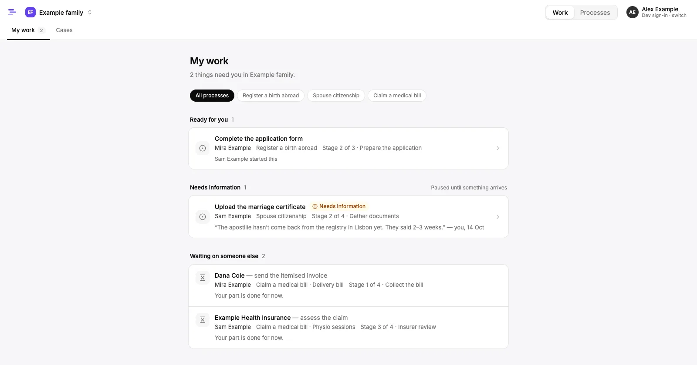
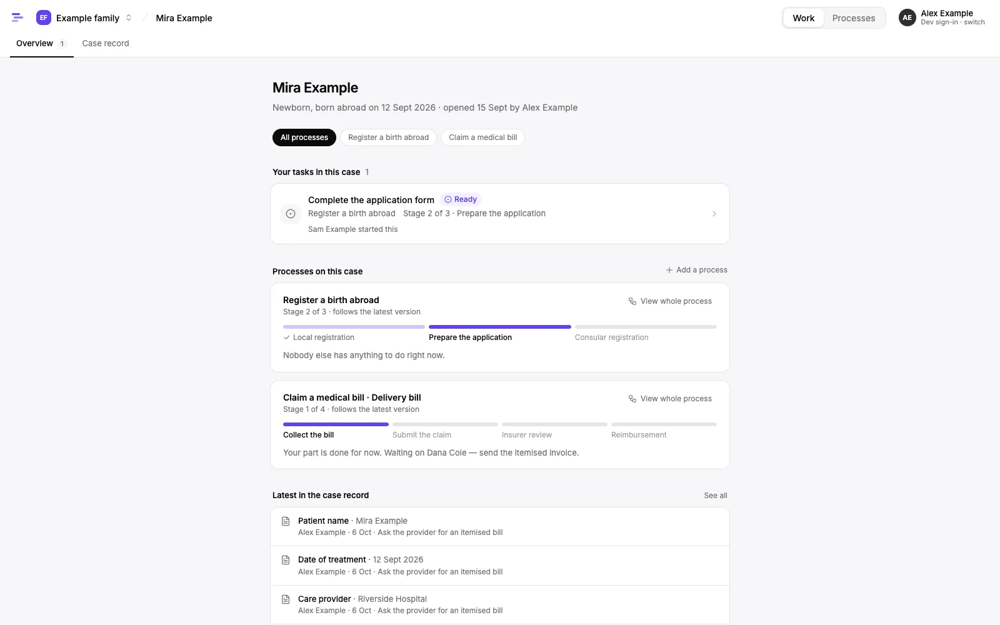
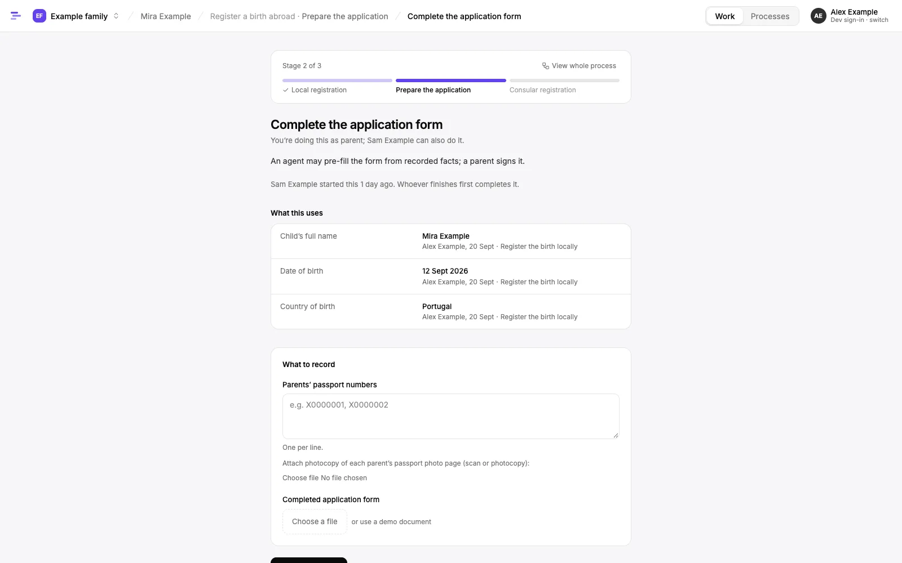
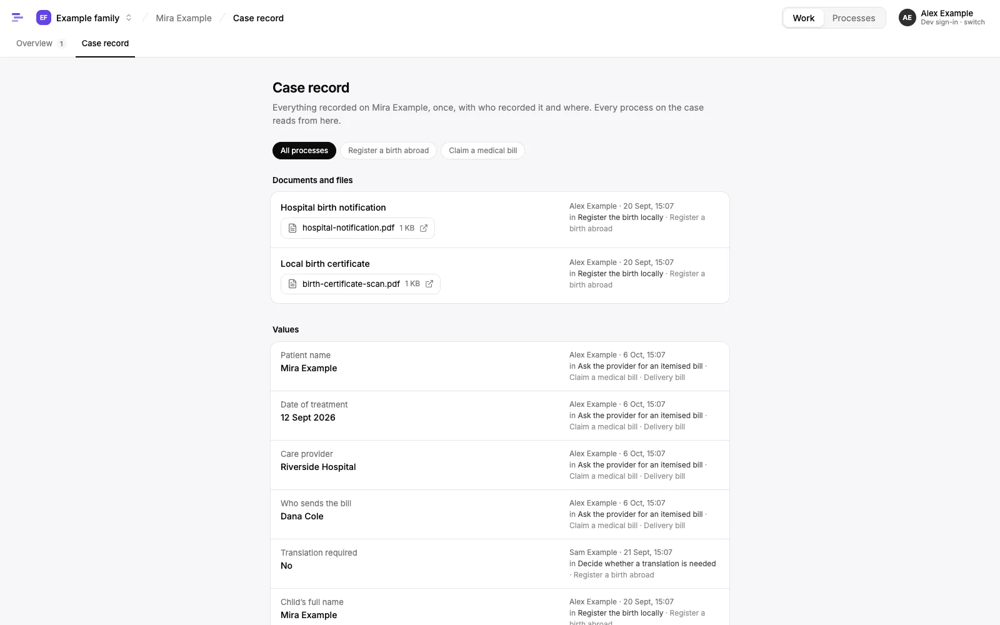
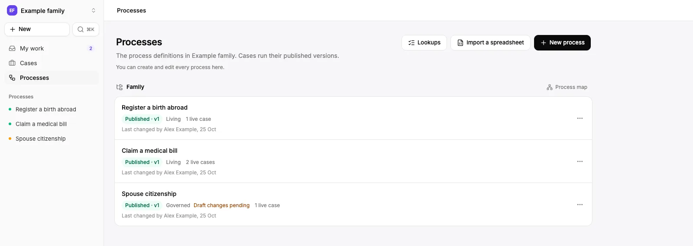
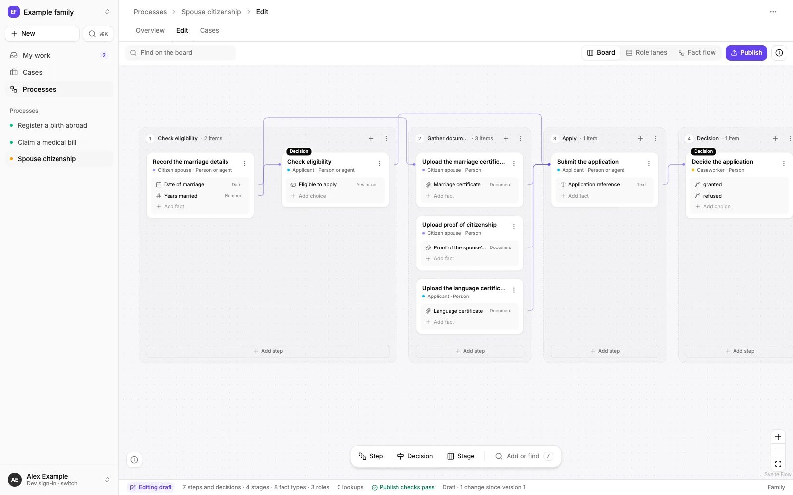
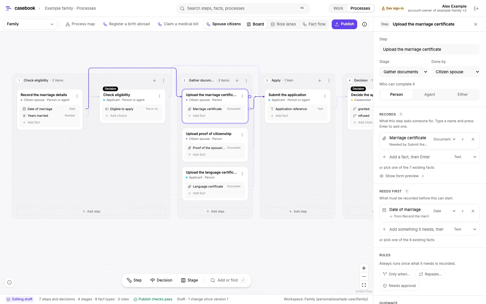
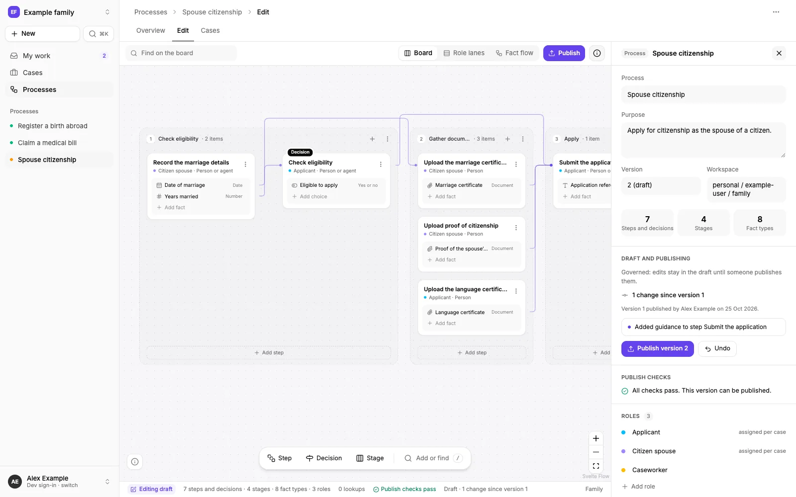

# casebook

Define, visualize and run human-in-the-loop processes as cases.

casebook is a generic process modeler and runner for business and human-in-the-loop processes, not necessarily automated.
Processes are stored as versioned definitions of stages, steps, facts, roles and approvals.
A case is the shared subject several processes attach to, sharing one fact store.
People and agents act on cases as principals within hierarchical namespaces.
v1 focuses on defining processes, viewing them as a graph, and an agent-assisted wizard that imports spreadsheets; running cases has begun (ADR 0022), and agents can work cases over MCP (ADR 0023).

## What it looks like

These screenshots come from `pnpm db:seed`: the synthetic sample processes and their made-up people, signed in as Alex Example.

**My work**: what waits on you across every case, from ready tasks to ones paused for information.



**A case workspace**: your tasks, then one stage strip per process attached to the case.



**A task form**: what the task uses from the case, with where each value came from, and what to record.



**The case record**: every value and file on the case, once, with who recorded it, when and in which task.



**Processes**: the instance's definitions with status, version, change policy and live cases.



**The board editor**: a process's stages are columns of step and decision cards, and lines show what each step needs from an earlier one.



**A step's Records and Needs first**: the facts a step records and the ones it needs first, edited in place.



**Draft and publishing**: what the draft changes since the latest published version, with the publish checks, Publish and Undo.



## Docs

- [Decision log](docs/decisions/README.md)
- [Roadmap](docs/roadmap.md)
- [Glossary](docs/glossary.md)

## Repository layout

A [moon](https://moonrepo.dev) workspace with pnpm workspaces underneath, all TypeScript.

| Path                    | What it is                                                                                                                             |
| ----------------------- | -------------------------------------------------------------------------------------------------------------------------------------- |
| `apps/web`              | SvelteKit 2 app (Svelte 5, Tailwind 4, shadcn-svelte): the runner and the process definition editor.                                   |
| `packages/model`        | Process-definition types, JSON Schema, validation, publish checks, node operations and the case runtime's pure logic. Pure TypeScript. |
| `packages/store`        | Postgres persistence, permission checks, definition editing, the case runtime and the demo seed; Drizzle ORM migrations.               |
| `packages/mcp`          | The MCP server: tools for agents to work cases as the user they sign in as, over Streamable HTTP with OAuth.                           |
| `packages/sheet-import` | Reads .xlsx workbooks into neutral rows and cells for the wizard.                                                                      |
| `packages/wizard-agent` | The spreadsheet wizard's authoring agent (deepagents), its state and the sample tracker.                                               |

## Prerequisites

- [proto](https://moonrepo.dev/proto) 0.60 or later. It installs the pinned moon, Node and pnpm versions from `.prototools`.
- Docker, for the local Postgres.

## Getting started

```sh
proto install            # moon, Node 22 and pnpm at the pinned versions
pnpm install
cp .env.example .env
pnpm db:up               # Postgres 17 on 127.0.0.1:5433
pnpm db:seed             # migrate, then load the demo accounts, users, processes and cases
pnpm dev                 # web app on http://localhost:5173
```

If port 5433 is taken, set `CASEBOOK_PG_PORT` in `.env` and update the port in `DATABASE_URL` to match.
Stop Postgres with `pnpm db:down`; its data stays in the `casebook-pgdata` volume.
`pnpm db:seed` does nothing once the demo account exists; to start again, run `docker compose down -v`, then `pnpm db:up` and `pnpm db:seed`.
Files attached to cases are stored on local disk in `CASEBOOK_FILES_DIR`, or `.casebook/files` under the directory the app or seed runs in.

## Running cases

`pnpm dev` opens on **My work** (ADR 0022).
The instance switcher at the top left moves between the accounts you belong to; inside one, **Work | Processes** switches between running cases and designing processes.

- **My work** lists what waits on you in that instance, in a fixed order: Ready for you, Needs information (paused, with the reason), Waiting on someone else (who, and any pause note), and a quiet Recurring group for repeating steps.
- **Cases** are workspaces: your tasks on the case, one stage strip per attached process with a line about what others are doing, and **View whole process**, a read-only list of every stage and step.
  The **Case record** lists every value and file on the case, once, with who recorded it, when and the task it came from.
- A **task** is one focused form: who it is for, what it uses (values already on the case, with where they came from) and what to record, typed from each fact's schema.
  There is no claim button: the first to finish completes it, and others see who has started.
  "I can’t finish this yet" pauses it with a note that whoever is waiting sees; a step whose condition is only prose can be marked as not applying.
- **Processes** lists the instance's definitions with status, version, change policy and live cases. A process opens on its own page, with **Edit** into the board editor, **Start a case**, the cases running it and a "Draft changes pending" note.
  A case is started by anyone with write access or a role in the process; **New case** and **Add a process** on a case use the same form.
- A **guest** holds a role in an account without belonging to it, such as a hospital's billing contact on one case. Guests see only **Requests for you**, and each form shows only the values it needs, one line of context and who asked.

The seed lays out a handful of cases in different stages, so each demo user's work differs.
"Use a demo document" stands in for an upload in development.

## Definition editor

**Processes → Edit** opens the editor, at `/i/<instance>/processes/edit`; older `/?ws=…&p=…` links still open it.
A process is built on the **board** (ADR 0021): its stages are columns, laid out from the definition, with step and decision cards in them.
Role lanes and a fact flow (Svelte Flow with an ELK layout) are read-only lenses on it, alongside a per-workspace process map of shared fact types.
Inspectors cover steps, decisions, stages, fact types and processes, including the publish checks from `packages/model`.

On the board, everything is added and linked in place:

- a stage's "+" or "Add step", a card's "+", right-click, `N` and `D`, or the palette (`/`) add a named step or decision;
- "Add stage" after the last column adds a stage, and a stage's menu moves it left or right;
- dragging a card's dot onto another step links them: the later step now needs what the earlier one records.
  Dragging a fact's dot or a decision's choice works the same way, and dropping in empty space adds a new step there;
- dragging a card onto another column moves it to that stage, and double-clicking a name renames it;
- a step's **Records** and **Needs first** add, rename, re-kind and remove its facts in place.

Definitions are read from and saved to Postgres through `packages/store` (`apps/web/src/lib/server/definitions.ts` and the form actions in `apps/web/src/routes/i/[instance]/processes/edit/+page.server.ts`).
Each workspace is a namespace the signed-in user can read.
Every gesture changes the draft through the model's node operations and is saved as one draft revision, with a notice that offers Undo (`⌘Z` too).
The process details list what the draft changes since the latest published version, with Publish and Undo.
A governed process publishes when someone presses Publish and the publish checks pass; a living process publishes every edit straight away.
"New process" (the + after the process tabs) starts a process in the workspace.

## Spreadsheet wizard

"Import a spreadsheet", beside the process tabs, turns an `.xlsx` tracker into processes (ADR 0011, ADR 0024); "Use the sample" imports a synthetic newborn tracker, also downloadable from `/wizard/sample`.
The board stays in view, with the assistant in a slide-over beside it that can be closed and reopened:

1. The assistant proposes how to split the workbook into processes, each with the cells it comes from. Rename, merge, split off a range or ask in chat for a different split, then accept it to create the processes.
2. It drafts a process as one proposal, shown on the board with new and changed cards marked and listed in the panel. Accept saves it to the draft as one revision; Reject drops it; a reply in chat revises it.
3. Publish runs the usual publish checks; when they fail, "Ask the assistant to fix it" sends them back.

The agent only proposes node operations, which the store checks as edits by the signed-in user, and every node it adds links back to its source cells.
It runs on any tool-calling chat model LangChain supports, set in `.env`:

| Setting                           | Default                  | Meaning                                                                                                          |
| --------------------------------- | ------------------------ | ---------------------------------------------------------------------------------------------------------------- |
| `CASEBOOK_WIZARD_MODEL`           | `ollama:qwen2.5:7b`      | `provider:model`, where the provider is `ollama`, `anthropic` (such as `anthropic:claude-sonnet-5`) or `openai`. |
| `OLLAMA_BASE_URL`                 | `http://127.0.0.1:11434` | Where Ollama runs; pull the model first with `ollama pull qwen2.5:7b`.                                           |
| `ANTHROPIC_API_KEY`               |                          | For `anthropic:` models.                                                                                         |
| `OPENAI_API_KEY`                  |                          | For `openai:` models; `OPENAI_BASE_URL` points it at a compatible server.                                        |
| `CASEBOOK_WIZARD_TIMEOUT_SECONDS` | `480`                    | How long one assistant turn may run before it is stopped with a message.                                         |

Small local models are slower and propose less, which shows up as proposals to reject or push back on rather than broken drafts.
The assistant runs one turn at a time on Ollama (turns on a hosted model run side by side), stops a turn still unfinished `CASEBOOK_WIZARD_TIMEOUT_SECONDS` after its request arrived, and shows what it is doing while it works; a large workbook is shown to the model as its tables and first rows, with the rest read on demand, so a turn stays within minutes on a local model.

Sign-in is a dev-only stand-in for OIDC: pick one of the seeded users at `/signin`, with no password.
It is on only in `pnpm dev`, never in a production build.
Every read and write acts as that user and goes through `can()`, and actions they cannot take are disabled with the reason.
The seed (`packages/store/src/seed.ts`) creates two accounts, `acme` ("Acme") and `example-family` ("Example family"), with these users, loads the model's synthetic fixtures as published definitions, and starts five cases:

| User                     | Access                                                      | In the demo cases                                                        |
| ------------------------ | ----------------------------------------------------------- | ------------------------------------------------------------------------ |
| Olive Owner              | account-owner of `acme`                                     | engineering director: signs off RCAs                                     |
| Devon Developer          | developer of `acme`, namespace-admin of `acme/eng/platform` | on-call engineer: reports incidents                                      |
| Wren Writer              | read-only of `acme`, write on `acme/eng`                    | incident commander: classifies and resolves incidents                    |
| Rae Reader               | read-only of `acme`                                         | reads the incidents; nothing to do                                       |
| Alex Example             | account-owner of `example-family`, read-only of `acme`      | a parent and claimant in the family; communications lead posting updates |
| Sam Example              | developer of `example-family`                               | the other parent; applying for citizenship                               |
| Dana Cole                | guest: care provider on one family case                     | sends a hospital's itemised invoice                                      |
| Example Health Insurance | guest: insurer in `personal/example-user/family`            | assesses claims                                                          |

## Agents over MCP

`pnpm dev:mcp` serves casebook to agents at `http://localhost:5190/mcp`, over Streamable HTTP (ADR 0023).
An agent signs in as one person with OAuth and then acts as them: it sees and does only what they can, and everything it records names the agent and the person it acted for.
Its tools mirror the runner: `list_my_work`, `list_processes`, `read_process`, `inspect_case`, `open_task`, `start_case`, `complete_task` (values, files and decisions), `start_task`, `pause_task`, `resume_task`, `skip_task` and `read_case_file`.
Approvals and steps marked human-only are refused to agents.

Sign-in is a dev-only authorization server in the same process: the client registers itself, your browser opens a page to pick one of the seeded users, with no password, and the client gets a 15-minute access token it refreshes for up to 8 hours.
Restarting the server signs every agent out. It refuses to run with `NODE_ENV=production`.
Set `CASEBOOK_FILES_DIR` in `.env` so the web app, the seed and the MCP server share case files.

Connect Claude Code:

```sh
claude mcp add --transport http casebook http://localhost:5190/mcp
```

or check in a `.mcp.json` like this, then run `/mcp` in Claude Code to sign in:

```json
{
  "mcpServers": {
    "casebook": { "type": "http", "url": "http://localhost:5190/mcp" }
  }
}
```

Claude Desktop reaches a local server through the `mcp-remote` bridge, in `claude_desktop_config.json`:

```json
{
  "mcpServers": {
    "casebook": { "command": "npx", "args": ["-y", "mcp-remote", "http://localhost:5190/mcp"] }
  }
}
```

Set `CASEBOOK_MCP_PORT` to use another port, and `CASEBOOK_MCP_URL` when clients reach the server at another origin.

## Checks

Each command runs the matching moon task across every project.

```sh
pnpm check               # type-check
pnpm lint                # ESLint
pnpm test                # Vitest
pnpm build               # build all projects
pnpm format              # Prettier (pnpm format:check to verify only)
```

Run a single project's task with moon directly, for example `moon run model:test`.
The `store` tests, which cover the seed, editing, publishing, running cases and permission refusals, the `mcp` tests, which cover the tools and the OAuth sign-in, and the `wizard-agent` tests that work through the store need Postgres (`pnpm db:up` and a `.env`): they migrate a throwaway database next to the one `DATABASE_URL` names, and are skipped when it is unset outside CI.
The wizard agent's tests use a scripted model; `CASEBOOK_LIVE_AGENT=1 moon run wizard-agent:test` also runs one against the configured model.

## Database migrations

Drizzle is configured in `packages/store/drizzle.config.ts` and reads `DATABASE_URL` from the root `.env`.

```sh
pnpm --filter @casebook/store db:generate   # generate SQL from src/schema.ts
pnpm --filter @casebook/store db:migrate    # apply migrations
```
